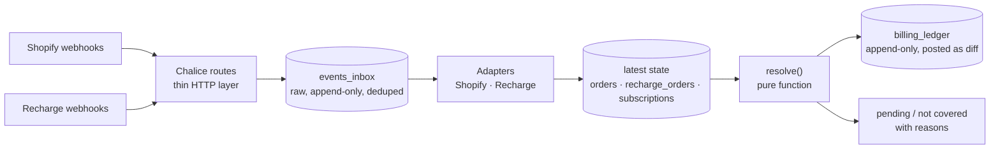

# 🛡️ TDD: ShipInsure Covered Orders (Shopify + Recharge) – Take-Home

> [!NOTE]
> **TL;DR:** A small Python prototype that treats webhooks as the system of record. Every Shopify and Recharge delivery is stored raw and deduplicated, coverage is **recomputed from stored state** after every event, and the billing ledger is posted as a **diff** between what should be billed and what already is. Result: the same final balance per order whether events arrive once, many times, or out of order.

**Status:** Plan, pre-build · **Owner:** Cai Cruz · **Audience:** Chris Busick (CTO), Nabin · **Build budget:** under 90 minutes, AI-assisted

---

## 1. Problem

ShipInsure learns about orders from Shopify webhooks and bills stores from a record of what was covered. A customer covers an order by adding the ShipInsure line item. When that order starts a Recharge subscription, every later order Recharge places is covered too.

**The key insight:** renewal orders usually do **not** carry the ShipInsure line item. Their coverage cannot be read from the order itself. It has to be **inherited** through links that come from two systems, in any order:

```text
Shopify order O (ShipInsure item -> covered)
   ^ external_order_id.ecommerce
Recharge order type=checkout  --purchase_item_id-->  Subscription S
Recharge order type=recurring --purchase_item_id-->  S
   v external_order_id.ecommerce
Shopify order R (no item -> covered because S's original order O is)
```

## 2. Main assumption (the whole linkage rests on it)

> [!WARNING]
> Recharge creates a `type = "checkout"` order for the first purchase, with `external_order_id.ecommerce` pointing at the original Shopify order. The 2021-11 Subscription object has no field linking back to its original order, so this is the only documented path. **If it doesn't hold** (e.g. some Shopify Checkout Integration stores), the fallback is matching the subscription to a Shopify order by customer + variant at creation time. Open question #1.

## 3. Architecture



1. **Persist first.** The route stores the raw body and headers in `events_inbox` and returns 200 once the row is durable. A duplicate delivery hits the unique dedupe key, bumps `delivery_count`, and is not processed again. A processing failure marks the row `failed` for retry; only a failed insert returns 5xx.
2. **Normalize.** An adapter per source turns the payload into upserts on the latest-state tables, guarded by `updated_at` so a stale event never regresses state. Recharge sits behind a one-method `SubscriptionPlatform` Protocol (`normalize()`), because ShipInsure supports several platforms.
3. **Recompute.** After every event, `resolve()` runs over **all** orders from stored state. It never reacts to "what just happened", so the result depends only on *which* events we have, not their order. (At prototype scale this is a loop; production would recompute only affected keys.)
4. **Post the diff.** For each order, compare *should be billed* with *already posted* and append the difference: a charge, or a negative adjustment. Nothing is ever updated or deleted.

## 4. Coverage rules: `resolve(order)`

| Case | Result |
| --- | --- |
| Order has the ShipInsure line item and is not cancelled | **covered (direct)**, premium = that line item's price |
| Order is linked to subscription S, S's original order is covered, S was not cancelled before this order was placed | **covered (inherited)**, premium = original order's premium |
| Linked to S but S's original order is unknown, or a Recharge order points at a Shopify order not seen yet | **pending**, with a reason (e.g. `missing_subscription_origin`) |
| Cancelled, or none of the above | **not covered** |

There is **no freeze**. Coverage always follows the current state of the original order, so an edit that removes the ShipInsure item flows through as an adjustment, and arrival order cannot change the outcome.

## 5. Data model (SQLite via SQLAlchemy 2.0, five tables)

| Table | Key | Holds |
| --- | --- | --- |
| `events_inbox` | **UNIQUE(source, dedupe_key)** | raw body + headers, topic, shop, received_at, delivery_count, status, error |
| `shopify_orders` | (shop, order_id) | ShipInsure premium (cents) or null, currency, created_at, cancelled_at, updated_at |
| `recharge_orders` | recharge_order_id | type (checkout / recurring), shopify_order_id, subscription_ids (JSON), status, updated_at |
| `subscriptions` | subscription_id | status, cancelled_at, updated_at |
| `billing_ledger` | **UNIQUE(shop, order_id, source_event_id)** | entry_type (charge / adjustment), amount_cents (signed integer), currency, basis, subscription_id, source_event_id |

- **Dedupe keys:** Shopify `X-Shopify-Webhook-Id` (documented per-delivery id). Recharge has no documented delivery id, so `{topic}:{object_id}:{updated_at}`; retries carry the same body, so the key is stable.
- **Money:** integer minor units + ISO currency, parsed with `Decimal`, no float.
- **Traceability:** every ledger row points at the inbox event that caused it, so any line on a bill traces back to a raw webhook.
- **Persistence:** SQLAlchemy declarative models define the schema and its unique constraints (`create_all()`, no migrations tool). The three correctness-critical writes stay atomic, single-statement upserts using SQLite's `insert().on_conflict_do_update()`: inbox dedupe (bump `delivery_count`), state upserts guarded by `updated_at`, and ledger posting. No read-then-write in Python: idempotency lives in the schema, not in an `if`.

## 6. Decisions and trade-offs

| Decision | Why | Trade-off |
| --- | --- | --- |
| Recompute everything after each event | Order-independence by construction; easy to prove | O(n) per event; fine for a prototype, incremental in production |
| Ledger posted as a diff, not "insert charge once" | Handles a decision that changes after billing (late cancellation, item removed) with no special cases | Same **final balance** regardless of order; the *sequence* of entries can differ (e.g. charge then reversal) |
| Renewal premium = original order's premium | Matches "the subscription is covered"; simplest | Real pricing may differ. Open question #2 |
| Shopify fixtures use the REST webhook shape | Shopify webhooks deliver the REST resource, not the GraphQL Order linked in the brief | Field names mapped to the GraphQL Order in the appendix |
| Synchronous processing in the request | Fits the budget | Recharge allows 5s; production would ack, then process from a queue |
| Chalice as a thin HTTP layer over plain functions | ShipInsure's stack; logic stays testable without HTTP | No Docker, no UI; terminal output instead |
| SQLAlchemy ORM for schema and reads, dialect upserts for critical writes | Readable models; constraints visible in code; Postgres becomes a connection-string change | One more dependency; must avoid ORM read-then-write on the idempotent paths |

## 7. Test plan (fixture replay)

Fixtures are JSON shaped like the documented objects, replayed through the ingest function against a fresh SQLite file.

| # | Scenario | Expect |
| --- | --- | --- |
| 1 | Happy path: original order → subscription → checkout order → renewal | 2 charges (direct + inherited), 0 pending |
| 2 | Every delivery sent 3× | 1 inbox row each with delivery_count = 3; ledger unchanged |
| 3 | **All permutations** of scenario 1 | Identical final coverage and per-order balances every time |
| 4 | Checkout order missing, then arrives late | Renewal pending with reason → charged once it arrives |

Scenario 3 is the core evidence: it covers out-of-order and stale-update cases in one test.

## 8. Build plan (90 min)

| Min | Block | Who |
| --- | --- | --- |
| 0–15 | Schema, inbox ingest + dedupe, Chalice routes | AI drafts, I review |
| 15–25 | Fixtures from the documented objects | AI drafts, I check against docs |
| 25–55 | Adapters, `resolve()`, ledger diff | AI drafts, I review/edit |
| 55–75 | Four scenarios incl. permutation test | AI drafts, I review/edit |
| 75–90 | README: run steps, critical paths, AI usage note | AI drafts, I review/edit |

**Run:** `pip install -r requirements.txt && pytest` · `python replay.py scenarios/out_of_order.json` prints the inbox, coverage, pending, and ledger tables.

## 9. Critical paths

### Built

1. Raw, append-only inbox; persist before processing
2. Duplicate deliveries (dedupe key + idempotent ledger)
3. Out-of-order delivery (state-based recompute)
4. Renewal coverage inherited through the Recharge linkage
5. Missing links surfaced as pending with a reason, resolved automatically
6. Decisions that change after billing → adjustments (cancellation, item removed)

### Considered, not built

1. **Reconciliation polling** (Shopify orders by `updated_at`, Recharge `/orders`) for webhooks that never arrive. Shopify explicitly says delivery isn't guaranteed. Results would enter the same inbox as `source=shipinsure`.
2. **Signature verification** (Shopify base64 HMAC-SHA256; Recharge hex sha256 of secret + body).
3. **Ack fast, process async**: queue, retries, dead-letter, reprocess failed inbox rows.
4. **Incremental recompute** of affected keys only.
5. **Subscription lifecycle**: skip, swap, pause/reactivate, prepaid, onetime items, refunds and partial refunds.
6. **Billing periods**: late events post into the current period, never edit a closed one.
7. **Multi-tenant**: per-shop secrets, app uninstall.
8. **Observability**: pending age alerts, duplicate rate, failed rows, ledger vs order counts.
9. **Currency**: presentment vs shop currency, 0- and 3-decimal currencies.
10. **Other platforms** via `SubscriptionPlatform`; Shopify native subscription contracts.
11. **Storage**: SQLite doesn't survive Lambda. SQLAlchemy makes Postgres a connection-string change; DynamoDB would need a new repository layer. Inbox retention and PII.

## 10. Open questions

1. On all store setups, can we rely on Recharge's checkout order to link a subscription to its original Shopify order? If not, what do you use?
2. Renewal pricing: original premium, or recomputed per renewal?
3. How is the ShipInsure line item identified in production (product/variant per shop, SKU, property)?
4. Billing timing: at creation or fulfillment? When does a period close?
5. Does Recharge send a per-delivery id you dedupe on in production?

---

## Appendix: field verification

| Field | Source | Status |
| --- | --- | --- |
| `type`, `external_order_id.ecommerce`, `line_items[].purchase_item_id` / `purchase_item_type`, `status`, `updated_at` | Recharge 2021-11 Order | ✅ Verified |
| Subscription `status`, `cancelled_at`, `updated_at` | Recharge 2021-11 Subscription | ✅ Verified |
| Webhook body = REST GET payload; retries over 48h; 5s timeout; duplicates possible | Recharge webhooks overview | ✅ Verified |
| `X-Shopify-Webhook-Id`, `X-Shopify-Topic`, `X-Shopify-Shop-Domain`, `X-Shopify-Hmac-Sha256`, `X-Shopify-Triggered-At` | Shopify delivery structure | ✅ Verified |
| Ordering not guaranteed; build reconciliation | Shopify webhooks | ✅ Verified |
| Webhook payload is the REST resource; REST `id`, `line_items`, `cancelled_at`, `updated_at` map to GraphQL `legacyResourceId`, `lineItems`, `cancelledAt`, `updatedAt` | Shopify | ⚠️ REST field names to confirm when writing fixtures |
| Recharge topic header / per-delivery id | Recharge | ⚠️ Unverified; topic passed in the route instead |
| Checkout order exists on all store setups | Recharge | ⚠️ Unverified (main assumption, §2) |

**References:** [Shopify webhooks](https://shopify.dev/docs/apps/build/webhooks) · [Delivery structure](https://shopify.dev/docs/apps/build/webhooks/delivery-structure) · [Shopify Order (GraphQL)](https://shopify.dev/docs/api/admin-graphql/latest/objects/order) · [Recharge webhooks](https://docs.getrecharge.com/docs/webhooks-overview) · [Recharge Orders 2021-11](https://developer.rechargepayments.com/2021-11/orders/orders_object) · [Recharge Subscriptions 2021-11](https://developer.rechargepayments.com/2021-11/subscriptions/subscriptions_object)
