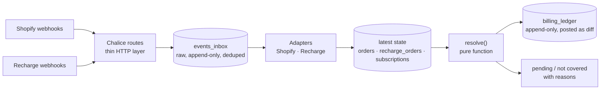

# 🛡️ TDD: ShipInsure Covered Orders (Shopify + Recharge) – Take-Home

> [!NOTE]
> **TL;DR:** A small Python prototype that treats webhooks as the system of record. Every Shopify and Recharge delivery is stored raw and deduplicated, coverage is **recomputed from stored state** after every event, and the billing ledger is posted as a **diff** between what should be billed and what already is. Renewal orders inherit coverage from the subscription's original Shopify order, which is found by **matching** customer, product and time, because on today's Shopify-checkout stores no record links the two directly. Result: the same final balance per order whether events arrive once, many times, or out of order, and a renewal is never billed on a guess.

**Status:** Built, revised after verifying the Recharge linkage · **Owner:** Cai Cruz · **Audience:** Chris Busick (CTO), Nabin · **Build budget:** under 90 minutes, AI-assisted

---

## 1. Problem

ShipInsure learns about orders from Shopify webhooks and bills stores from a record of what was covered. A customer covers an order by adding the ShipInsure line item. When that order starts a Recharge subscription, every later order Recharge places is covered too.

**The key insight:** renewal orders usually do **not** carry the ShipInsure line item. Their coverage cannot be read from the order itself. It has to be **inherited** from the subscription's original order, through links that come from two systems, in any order:

```text
Shopify order O   (customer C, variant V, ShipInsure item -> covered)
   ^ matched: same customer C, contains variant V, placed shortly before S was created
Recharge Subscription S   (customer_id, external_variant_id.ecommerce = V, created_at)
   ^ line_items[].purchase_item_id
Recharge order type=recurring   (customer.external_customer_id.ecommerce = C)
   v external_order_id.ecommerce
Shopify order R   (no item -> covered because S's original order O is)
```

## 2. How Recharge works on Shopify today (the linkage rests on this)

Since Shopify's Subscription APIs (API version 2021-01), Recharge runs on Shopify as the **Shopify Checkout Integration**: the customer buys through Shopify's own checkout, and Recharge manages the subscription. Shopify ended subscription checkouts that bypass its own on **October 18, 2024**, so this is the only flow for new subscriptions.

Recharge's own order-flow diagrams for this setup show:

- **First purchase:** Shopify product page → cart → checkout → Shopify order created → Shopify order webhook → Recharge creates the *customer, address, subscription, and queued charge*. Recharge creates **no order** for the first purchase, so nothing in Recharge points at the original Shopify order.
- **Renewals:** Recharge sends a billing attempt to Shopify → Shopify charges and creates the order → Recharge marks its charge successful. A Recharge order is created when a charge succeeds, so a `type = "recurring"` order points at the Shopify renewal through `external_order_id.ecommerce`.

There is no direct link from a subscription to its original order that ShipInsure can read. The Recharge 2021-11 Subscription has no such field. Shopify's subscription contract has `origin_order_id`, but contracts need the `read_own_subscription_contracts` scope, which covers only contracts the app itself owns, and Recharge owns them.

> [!WARNING]
> **Main assumption:** Recharge creates the subscription shortly after the original Shopify order. Among that customer's Shopify orders, the one that contains the subscription's variant and was placed within a short window before `subscription.created_at` is the original order. With exactly one candidate, the renewal inherits coverage. With none or several, it stays **pending with a reason** and is never billed on a guess. Open question #1.

## 3. Architecture



1. **Persist first.** The route stores the raw body and headers in `events_inbox` and returns 200 once the row is durable. A duplicate delivery hits the unique dedupe key, bumps `delivery_count`, and is not processed again. A processing failure marks the row `failed` for retry; only a failed insert returns 5xx.
2. **Normalize.** An adapter per source turns the payload into upserts on the latest-state tables, guarded by `updated_at` so a stale event never regresses state. Recharge sits behind a one-method `SubscriptionPlatform` Protocol (`normalize()`), because ShipInsure supports several platforms.
3. **Recompute.** After every event, `resolve()` runs over **all** orders from stored state, including the origin match. It never reacts to "what just happened", so the result depends only on *which* events we have, not their order. (At prototype scale this is a loop; production would recompute only affected keys.)
4. **Post the diff.** For each order, compare *should be billed* with *already posted* and append the difference: a charge, or a negative adjustment. Nothing is ever updated or deleted.

## 4. Coverage rules: `resolve(order)`

| Case | Result |
| --- | --- |
| Order has the ShipInsure line item and is not cancelled | **covered (direct)**, premium = that line item's price × `current_quantity` (refunded or removed units don't count) |
| Order is linked to subscription S by a recurring Recharge order, S's original order is matched and covered, S was not cancelled before this order was placed | **covered (inherited)**, premium = original order's premium |
| Linked to S, but S's original order can't be identified yet | **pending**: `missing_subscription` (S not seen), `missing_subscription_origin` (no candidate order), or `ambiguous_subscription_origin` (more than one) |
| A Recharge order points at a Shopify order not seen yet | **pending**: `missing_shopify_order` |
| Cancelled, or none of the above | **not covered** |

**Origin match** for subscription S: Shopify orders where the customer is the one on the recurring Recharge order, a line item has variant `S.external_variant_id`, `created_at` is at or before `S.created_at` and within the window (default 1 hour, configurable), and the order is not itself a renewal (no recurring Recharge order points at it).

There is **no freeze**. Coverage always follows the current state, so an edit that removes the ShipInsure item flows through as an adjustment, a second matching order that arrives later turns a charge into pending (and reverses it), and arrival order cannot change the outcome.

## 5. Data model (SQLite via SQLAlchemy 2.0, five tables)

| Table | Key | Holds |
| --- | --- | --- |
| `events_inbox` | **UNIQUE(source, dedupe_key)** | raw body + headers, topic, shop, received_at, delivery_count, status, error |
| `shopify_orders` | (shop, order_id) | customer_id, variant_ids (JSON), ShipInsure premium (cents) or null, currency, created_at, cancelled_at, updated_at |
| `recharge_orders` | recharge_order_id | type, shopify_order_id, shopify_customer_id, subscription_ids (JSON), status, updated_at |
| `subscriptions` | subscription_id | recharge customer_id, shopify variant_id, status, created_at, cancelled_at, updated_at |
| `billing_ledger` | **UNIQUE(shop, order_id, source_event_id)** | entry_type (charge / adjustment), amount_cents (signed integer), currency, basis, subscription_id, source_event_id |

- **Dedupe keys:** Shopify `X-Shopify-Webhook-Id` (documented per-delivery id, meant for deduplication). Recharge documents no delivery id, so `{topic}:{object_id}:{updated_at}`; retries carry the same body, so the key is stable.
- **Money:** integer minor units + ISO currency, parsed with `Decimal`, no float.
- **Traceability:** every ledger row points at the inbox event that caused it, so any line on a bill traces back to a raw webhook.
- **Persistence:** SQLAlchemy declarative models define the schema and its unique constraints (`create_all()`, no migrations tool). The three correctness-critical writes stay atomic, single-statement upserts using SQLite's `insert().on_conflict_do_update()`: inbox dedupe (bump `delivery_count`), state upserts guarded by `updated_at`, and ledger posting. No read-then-write in Python: idempotency lives in the schema, not in an `if`.

## 6. Decisions and trade-offs

| Decision | Why | Trade-off |
| --- | --- | --- |
| Find the original order by customer + variant + time | The only data ShipInsure can see that ties a subscription to its first order on Shopify-checkout stores | A heuristic: two qualifying orders make it ambiguous, so the renewal waits as pending rather than guessing |
| Build for the Shopify Checkout Integration only | The only Recharge flow for new subscriptions on Shopify since October 2024 | Subscriptions created on Recharge's legacy checkout aren't linked (§9) |
| Recompute everything after each event | Order-independence by construction; easy to prove | O(n) per event; fine for a prototype, incremental in production |
| Ledger posted as a diff, not "insert charge once" | Handles a decision that changes after billing (late cancellation, item removed, new ambiguity) with no special cases | Same **final balance** regardless of order; the *sequence* of entries can differ (e.g. charge then reversal) |
| Renewal premium = original order's premium | Matches "the subscription is covered"; simplest | Real pricing may differ. Open question #2 |
| Shopify fixtures use the REST webhook shape | Shopify webhooks deliver the REST resource, not the GraphQL Order linked in the brief | Field names mapped to the GraphQL Order in the appendix |
| Synchronous processing in the request | Fits the budget | Recharge allows 5s; production would ack, then process from a queue |
| Chalice as a thin HTTP layer over plain functions | ShipInsure's stack; logic stays testable without HTTP | No Docker, no UI; terminal output instead |
| SQLAlchemy ORM for schema and reads, dialect upserts for critical writes | Readable models; constraints visible in code; Postgres becomes a connection-string change | One more dependency; must avoid ORM read-then-write on the idempotent paths |

## 7. Test plan (fixture replay)

Fixtures are JSON shaped like the documented objects, replayed through the ingest function against a fresh SQLite file.

| # | Scenario | Expect |
| --- | --- | --- |
| 1 | Happy path: original order → subscription → renewal → recurring Recharge order | 2 charges (direct + inherited), 0 pending |
| 2 | Every delivery sent 3× | 1 inbox row each with delivery_count = 3; ledger unchanged |
| 3 | **All permutations** of scenario 1, and of the scenarios with an update event | Identical final coverage and per-order balances every time |
| 4 | Original order arrives last | Renewal pending (`missing_subscription_origin`) → charged once it arrives |
| 5 | Two qualifying original orders | Renewal pending (`ambiguous_subscription_origin`), never charged |
| 6 | Earlier renewal for the same customer and variant | Not mistaken for the original order |
| 7 | Late cancellation, ShipInsure item removed, subscription cancelled | Negative adjustments; a renewal placed after cancellation is not covered |

Scenario 3 is the core evidence: it covers out-of-order and stale-update cases in one test.

## 8. Build plan (90 min)

| Min | Block | Who |
| --- | --- | --- |
| 0–15 | Schema, inbox ingest + dedupe, Chalice routes | AI drafts, I review |
| 15–25 | Fixtures from the documented objects | AI drafts, I check against docs |
| 25–55 | Adapters, `resolve()`, ledger diff | AI drafts, I review/edit |
| 55–75 | Scenarios incl. permutation test | AI drafts, I review/edit |
| 75–90 | README: run steps, critical paths, AI usage note | AI drafts, I review/edit |

**Run:** `pip install -r requirements-dev.txt && pytest` · `python replay.py scenarios/out_of_order.json` prints the inbox, coverage, pending, and ledger tables. See the [README](../README.md) for the local server and Postman collection.

## 9. Critical paths

### Built

1. Raw, append-only inbox; persist before processing
2. Duplicate deliveries (dedupe key + idempotent ledger)
3. Out-of-order delivery (state-based recompute)
4. Renewal coverage inherited: recurring Recharge order → subscription → matched original Shopify order
5. Missing or ambiguous links surfaced as pending with a reason, resolved automatically when the data arrives
6. Decisions that change after billing → adjustments (cancellation, item removed, new ambiguity)

### Considered, not built

1. **Legacy Recharge Checkout on Shopify.** Before Shopify's October 18, 2024 cutoff, Recharge could run its own checkout on Shopify stores. It created a `type = "checkout"` Recharge order whose `external_order_id.ecommerce` pointed at the original order: a direct link, no matching needed. New subscriptions can't be created that way anymore, but stores Recharge migrated to Shopify Checkout may still have older subscriptions from it, and linking those would mean backfilling checkout orders from the Recharge API. Kept out of scope for the prototype.
2. **Reconciliation polling** (Shopify orders by `updated_at`, Recharge `/orders`) for webhooks that never arrive. Shopify explicitly says delivery isn't guaranteed. Results would enter the same inbox as `source=shipinsure`.
3. **Signature verification** (Shopify base64 HMAC-SHA256; Recharge hex SHA-256 of client secret + body).
4. **Ack fast, process async**: queue, retries, dead-letter, reprocess failed inbox rows.
5. **Incremental recompute** of affected keys only.
6. **Subscription lifecycle**: skip, swap (a swapped variant no longer matches the original order), pause/reactivate, prepaid, onetime items, refunds and partial refunds.
7. **Billing periods**: late events post into the current period, never edit a closed one.
8. **Multi-tenant**: per-shop secrets, app uninstall.
9. **Observability**: pending age alerts (especially `ambiguous_subscription_origin`), duplicate rate, failed rows, ledger vs order counts.
10. **Currency**: presentment vs shop currency, 0- and 3-decimal currencies.
11. **Other platforms** via `SubscriptionPlatform`; Shopify's own subscription contracts if ShipInsure ever owns them.
12. **Storage**: SQLite doesn't survive Lambda. SQLAlchemy makes Postgres a connection-string change; DynamoDB would need a new repository layer. Inbox retention and PII.

## 10. Open questions

1. On Shopify-checkout stores, how do you link a Recharge subscription to its original order today? Is there a Recharge field, endpoint or app-level signal we missed?
2. Renewal pricing: original premium, or recomputed per renewal?
3. How is the ShipInsure line item identified in production (product/variant per shop, SKU, property)?
4. Billing timing: at creation or fulfillment? When does a period close?
5. How long can Recharge take to create a subscription after the Shopify order, i.e. what should the match window be?
6. Do any of your stores still have subscriptions from Recharge's legacy checkout?

---

## Appendix: field verification

| Field | Source | Status |
| --- | --- | --- |
| Order `type` (`checkout` / `recurring`), `external_order_id.ecommerce`, `line_items[].purchase_item_id` / `purchase_item_type` (`subscription` / `onetime`), `customer.external_customer_id.ecommerce`, `status`, `updated_at` | Recharge 2021-11 Order | ✅ Verified |
| Subscription `customer_id`, `external_variant_id.ecommerce`, `created_at`, `status`, `cancelled_at`, `updated_at`; **no** field for the original order | Recharge 2021-11 Subscription | ✅ Verified |
| Webhook body = REST GET payload; 5s timeout; 20 retries over 48h; duplicates possible | Recharge webhooks overview | ✅ Verified |
| Only `X-Recharge-Hmac-Sha256` is documented: no topic header, no delivery id | Recharge webhooks overview | ✅ Verified (topic passed in the route) |
| First purchase on Shopify checkout creates no Recharge order; Recharge creates customer, address, subscription, queued charge | Recharge order flow, Shopify Checkout Integration | ⚠️ Shown in Recharge's flow diagram, not stated as a rule |
| Renewal: a recurring Recharge order points at the Shopify renewal order | Recharge Orders + recurring order flow | ⚠️ Strongly implied ("an order is created after a Charge is successfully processed") |
| Subscription contract `origin_order_id` exists but needs `read_own_subscription_contracts` (owning app only) | Shopify webhooks reference, access scopes | ✅ Verified: not readable by ShipInsure |
| Subscription APIs shipped in 2021-01; subscription apps must use Shopify Checkout | Shopify changelog, App Store requirements | ✅ Verified |
| Non-integrated subscription checkouts ended October 18, 2024 | Recharge blog, Ordergroove | ⚠️ Secondary sources |
| `X-Shopify-Webhook-Id` (per delivery, for deduplication), `X-Shopify-Event-Id`, `X-Shopify-Topic`, `X-Shopify-Shop-Domain`, `X-Shopify-Hmac-Sha256`, `X-Shopify-Triggered-At` | Shopify delivery structure | ✅ Verified |
| Ordering not guaranteed; build reconciliation | Shopify webhooks | ✅ Verified |
| Payload is the full REST resource; REST `id`, `line_items`, `cancelled_at`, `updated_at` map to GraphQL `legacyResourceId`, `lineItems`, `cancelledAt`, `updatedAt` | Shopify delivery structure, GraphQL Order | ✅ Verified |
| `customer.id`, `line_items[].variant_id`, `line_items[].current_quantity` (excludes refunded and removed units) | Shopify `orders/create` sample, GraphQL LineItem | ✅ Verified; `variant_id` can be null (custom items) |

**References:** [Shopify webhooks](https://shopify.dev/docs/apps/build/webhooks) · [Delivery structure](https://shopify.dev/docs/apps/build/webhooks/delivery-structure) · [Webhooks reference](https://shopify.dev/docs/api/webhooks/latest) · [Shopify Order (GraphQL)](https://shopify.dev/docs/api/admin-graphql/latest/objects/order) · [Access scopes](https://shopify.dev/docs/api/usage/access-scopes) · [App Store requirements](https://shopify.dev/docs/apps/launch/shopify-app-store/app-store-requirements) · [Subscription API scopes changelog](https://shopify.dev/changelog/subscriptions-api-scopes-are-now-available-by-request) · [Recharge webhooks](https://docs.getrecharge.com/docs/webhooks-overview) · [Recharge order flow on the Shopify Checkout Integration](https://support.getrecharge.com/hc/en-us/articles/4421426786967-Understanding-the-Recharge-order-flow-on-the-Shopify-Checkout-Integration) · [Recharge Orders 2021-11](https://developer.rechargepayments.com/2021-11/orders/orders_object) · [Recharge Subscriptions 2021-11](https://developer.rechargepayments.com/2021-11/subscriptions/subscriptions_object) · [Recharge: Shopify Checkout conversion](https://getrecharge.com/blog/shopify-checkout-conversion-what-you-need-to-know/) · [Ordergroove: non-integrated checkout shutdown](https://www.ordergroove.com/blog/shopify-nonintegrated-checkout-subscription-shutdown-guide/)
